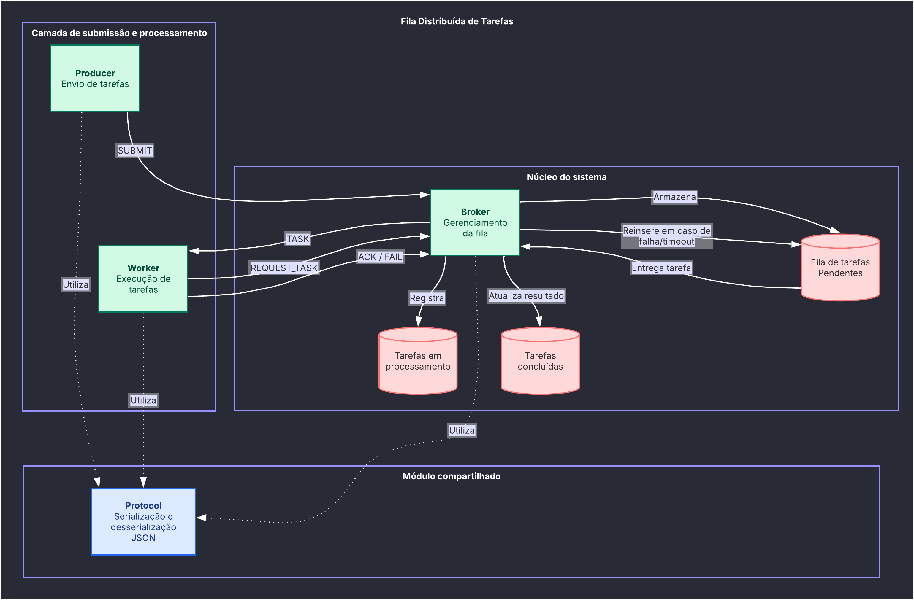
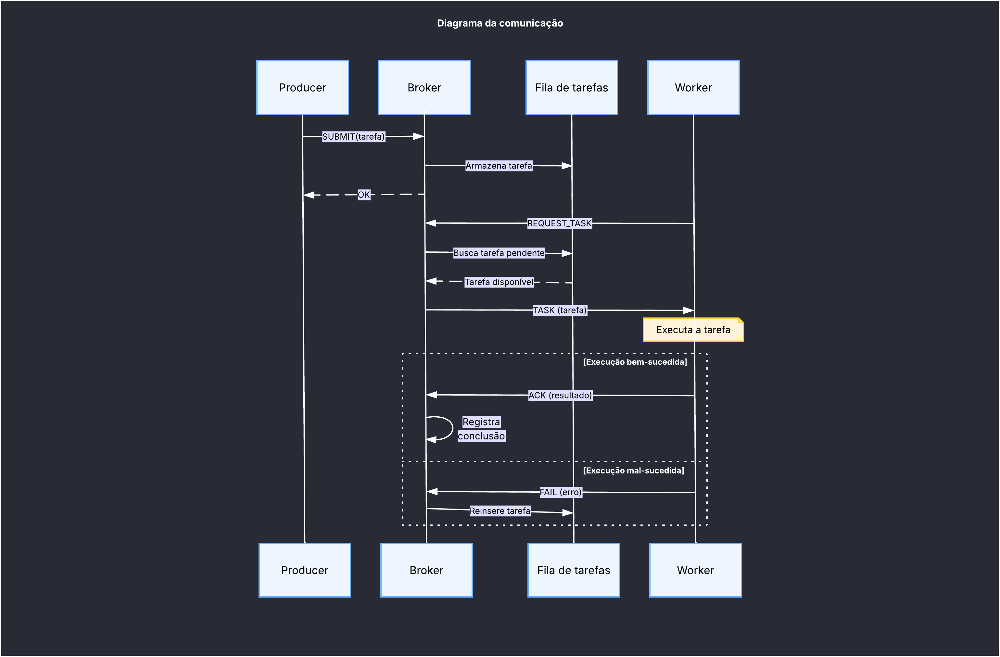

# Fila Distribuída de Tarefas

Projeto acadêmico desenvolvido para a disciplina de **Sistemas Distribuídos**, com o objetivo de implementar um sistema de gerenciamento e processamento distribuído de tarefas por meio de uma fila.

O grupo é composto por:
* David Melo
* Evelin Dionísio
* Heitor Carvalho
* Miguel Monteiro
* Pedro Henrique

## 1. Visão geral

O sistema permite desacoplar a submissão de tarefas de sua execução, possibilitando que diferentes processos produzam e consumam tarefas de maneira independente.

A arquitetura é composta por três componentes principais:

- **`Broker`:** recebe as tarefas, mantém a fila de pendências e gerencia sua distribuição e seus estados.
- **`Worker`:** solicita tarefas ao Broker, executa seu processamento e comunica o resultado por meio de confirmações.
- **`Producer`:** submete novas tarefas ao Broker para processamento pelos Workers.

## 2. Arquitetura do sistema

A comunicação entre os componentes ocorre por meio de conexões TCP, utilizando mensagens no formato JSON, conforme o protocolo compartilhado definido em `common/protocol.py`.

O Broker mantém três estruturas principais para o gerenciamento das tarefas: pendentes, em processamento e concluídas. Os Workers consomem as tarefas disponíveis e enviam mensagens de confirmação (`ACK`) ou falha (`FAIL`).

**Diagrama de componentes:**





## 3. Organização do repositório

```text
fila-distribuida/
├── broker/       # Gerenciamento da fila e distribuição
├── common/       # Protocolo de comunicação compartilhado
├── docs/         # Arquivos de documentação do projeto
├── producer/     # Estrutura para o produtor de tarefas
├── worker/       # Consumo e processamento de tarefas
├── scripts/      # Scripts de demonstração manual
├── tests/        # Testes automatizados
├── requirements.txt
└── README.md
```

## 4. Tecnologias utilizadas

- **Python:** implementação dos componentes.
- **Asyncio:** gerenciamento assíncrono das operações.
- **TCP:** comunicação entre os processos.
- **JSON:** serialização das mensagens.
- **Pytest:** testes automatizados.

## 5. Execução do projeto

### Pré-requisitos

- Python 3.10 ou superior.
- Pip.

### Instalação

```bash
git clone https://github.com/liito-0/fila-distribuida.git
cd fila-distribuida
pip install -r requirements.txt
```

### Inicialização do Broker

```bash
python -m broker.broker
```

### Inicialização do Worker

Em outro terminal:

```bash
python -m worker.worker --id worker-1
```

É possível executar múltiplas instâncias de Workers, utilizando identificadores diferentes.

### Envio de tarefas com o Producer

Em outro terminal, envie um payload simples:

```bash
python -m producer.producer --id producer-1 --payload "ola"
```

Envie três tarefas de texto em intervalos de um segundo:

```bash
python -m producer.producer --action uppercase --text "ola mundo" --count 3 --interval 1
```

Some uma lista de inteiros:

```bash
python -m producer.producer --action sum --numbers 1 2 3
```

### Testes manuais

```bash
python -m scripts.teste_manual
```

### Testes automatizados

```bash
python -m pytest -v
```
